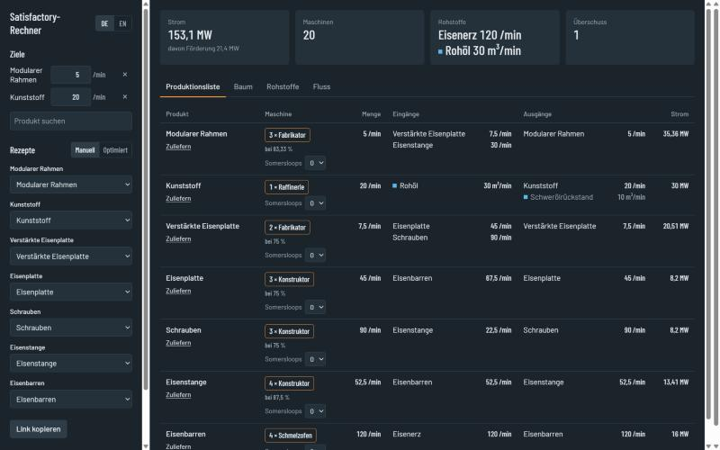

# Satisfactory-Rechner

Produktionsplaner für Satisfactory 1.0 im Browser, ohne Installation. Zielprodukte und Mengen pro Minute eingeben, der Rechner liefert Zwischenprodukte, Maschinen (Anzahl und Taktung), Rohstoffbedarf, Strom und Überschuss.



## Start

Python 3 wird benötigt (nur für den lokalen Server).

- Windows: `start.bat` ausführen, oder
- `python tools/serve.py 8765` im Projektordner, dann http://localhost:8765 öffnen.

Ist ein Port belegt (z. B. 8080), den Port im Befehl ändern oder einen freien wählen.

## Funktionen

- Produktionsbaum mit Maschinen und Taktung
- Alternativrezepte wählbar
- Optimierung auf Rohstoffe oder Strom
- Somersloops je Rezept
- Förderung mit Minern und Extraktoren, Reinheit und Takt
- Zuliefern: Items als Import statt Eigenproduktion
- Fluss-Graph der Produktion (Knoten verschiebbar, Details per Klick)
- Weltkarte mit allen Rohstoffknoten, Filter nach Rohstoff und Reinheit (Knotendaten: [Hirashi3630/satisfactory_node_heatmap](https://github.com/Hirashi3630/satisfactory_node_heatmap) über [rockfactory/satisfactory-logistics](https://github.com/rockfactory/satisfactory-logistics), beide MIT)
- Oberfläche und Itemnamen Deutsch und Englisch
- Pläne im Browser speichern und als Link teilen

## Spieldaten aktualisieren

`data/gamedata.js` wird generiert, nicht von Hand ändern:

```
python tools/extract_gamedata.py [--docs <Pfad>]
```

Das Skript liest `CommunityResources\Docs` der Spielinstallation (Pfad optional mit `--docs`).

Karte: `data/mapnodes.js` wird aus `src/recipes/WorldResourceNodes.json` von rockfactory/satisfactory-logistics erzeugt:

```
python tools/extract_mapnodes.py --src <Pfad zu WorldResourceNodes.json>
```

Kartenbild (`data/maptiles/4/`): `python tools/fetch_maptiles.py` lädt die Kacheln neu; Rohstoff-Icons (`data/icons/`): `python tools/fetch_icons.py`.

## Tests

Server starten und http://localhost:8765/tests/ im Browser öffnen.

## Hinweis

Inoffizielles Fan-Tool, nicht mit Coffee Stain Studios verbunden. Die Spieldaten stammen aus den Community-Docs des Spiels. Die Weltförderlimits in `js/resourceLimits.js` sind Richtwerte aus dem Satisfactory-Wiki. Kartenbild und Rohstoff-Icons (aus dem Satisfactory-Wiki) sind Eigentum von Coffee Stain Studios und wird wie in anderen Fan-Tools nur als Orientierung gezeigt.

## English

Unofficial production planner for Satisfactory 1.0 that runs in the browser, no installation. Enter target items and rates per minute to get intermediate products, machines with clock speeds, raw resources, power and surplus. Features: alternate recipes, optimization for resources or power, somersloops, extraction (miners, extractors, purity, clock), imports, flow graph, German/English UI, saved plans and shareable links.

Start: run `start.bat` or `python tools/serve.py 8765` (Python 3 required) and open http://localhost:8765. Update game data with `python tools/extract_gamedata.py [--docs <path>]` (reads `CommunityResources\Docs` of the game install). Tests: http://localhost:8765/tests/.

Fan project, not affiliated with Coffee Stain Studios. Game data comes from the game's community docs; world extraction limits in `js/resourceLimits.js` are approximate values from the Satisfactory wiki. The map image and resource icons (from the Satisfactory wiki) are property of Coffee Stain Studios, shown for reference only as in other fan tools.
